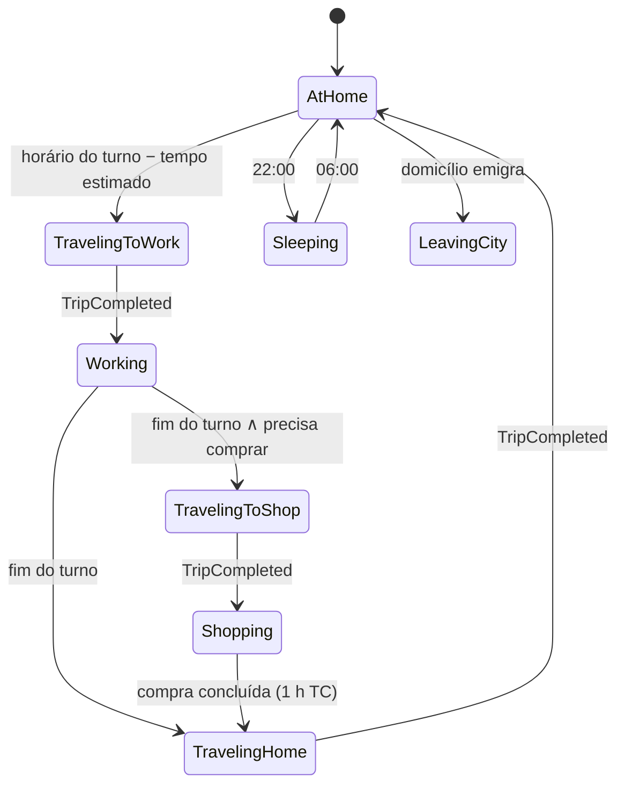

# Sistema de Cidadãos

> **Status:** v1.0 · **Data:** 2026-10-08 · **ADR:** [0009](ADR/0009-citizen-simulation.md) · **MVP:** sim (adultos, rotina casa-trabalho-mercado, a pé)

---

## 1. Intenção
Cidadãos são **agentes reais** (§12): moram, trabalham, recebem, gastam, se deslocam, têm necessidades e afetam a cidade. O **estado** deles vive no Domain (orientado a dados). A **representação visual** é responsabilidade da apresentação (`SIMULATION_LOD.md`).

## 2. Dados (`CitizenStore`, SoA)
| Campo (§12) | Representação | MVP |
|---|---|---|
| Identity | `CitizenId` + `NameSeed` (nome gerado de forma determinística por tabelas pt-BR) | ✅ |
| Age | `AgeGroup` (Child, Teen, Adult, Senior) + idade em dias | Adult |
| Household | `HouseholdId` | ✅ |
| Home | derivado do domicílio | ✅ |
| Job | `BuildingId` do local de trabalho | ✅ |
| Income | salário (derivado do emprego) | ✅ |
| Money | **conta do domicílio** (não individual, por simplicidade) | ✅ |
| Health | 0–10000 | Fase 13 |
| Education | nível (0–4) | Fase 13 |
| Happiness | `HappinessState` | ✅ |
| Needs | `NeedsState` | ✅ (4 necessidades) |
| Schedule | `ScheduleTemplateId` + próxima decisão | ✅ |
| CurrentActivity | enum + `TripId` | ✅ |

## 3. Máquina de estados da atividade (State pattern)

- Decisões ocorrem no `ScheduleSystem` em **baldes** (cada cidadão a cada 15 min TC).
- Desempregado: fica em casa e procura emprego (o `EmploymentSystem` faz o *matching*). Fase 13: lazer, escola, saúde.

## 4. Agenda
- **Templates** por perfil (MVP: "trabalhador diurno" 08:00–16:00, com variação determinística de ±1 h por cidadão para espalhar o pico).
- O horário de saída é **calculado** pelo tempo de viagem estimado (cache de caminho) mais uma folga, para chegar no horário (ver `SIMULATION_TICK.md` §2.1).
- Compras: se a necessidade *Consumo* < 50% e há mercado alcançável com estoque, depois do trabalho.

## 5. Emprego
- `EmploymentSystem` (1 h TC): vagas abertas × desempregados. Prioridade por distância (cache de caminho) e, a partir da Fase 13, por educação compatível.
- Contratação e demissão geram eventos e entram no ledger (salário diário).

## 6. Chegada e saída (com `HOUSEHOLD_SYSTEM.md`)
- Chegada: o `MigrationSystem` (diário, 06:00) cria domicílios se houver moradia livre **e** a atratividade ≥ limiar (felicidade média, empregos, termômetro).
- Saída: domicílio com felicidade média < 30% por 3 dias TC consecutivos emigra (evento + notificação com causa principal).

## 7. Interação com outros sistemas
| Sistema | Interação |
|---|---|
| Pathfinding/Trips | pede caminhos e cria viagens |
| Economia | salário (empresa → domicílio), compras (domicílio → empresa) |
| Energia | casa sem energia → necessidade *Energia* cai |
| Felicidade | agrega necessidades e penalidades |
| Inspector | read model `CitizenDetails` (exemplo do §36: nome, idade, profissão, salário, casa, trabalho, felicidade, próxima atividade, destino, rota) |

## 8. Player API
Somente leitura: `Citizen.Name`, `Age`, `Home`, `Workplace`, `Salary`, `Happiness`, `CurrentActivity`. O aluno **não cria** cidadãos nem define salários (CRITICAL_ANALYSIS D6). Ele influencia a população com moradia, empregos, serviços e impostos.

## 9. Desempenho
| Escala | Custo por tick (alvo, .NET 10) |
|---|---|
| 50 (MVP) | desprezível |
| 10.000 | ≤ 0,3 ms |
| 100.000 | ≤ 1,5 ms (baldes + SoA) |
Memória: ≈ 64–128 bytes por cidadão nos stores principais (≈ 13 MB para 100k), mais as necessidades e a felicidade.

## 10. Testes
- Máquina de estados: todas as transições, horários de borda (meia-noite, turnos).
- Agenda: chega ao trabalho no horário com caminho conhecido.
- Determinismo da geração de nomes.
- Invariantes: todo cidadão pertence a um domicílio ativo, e nenhum está "viajando" sem `Trip`.
