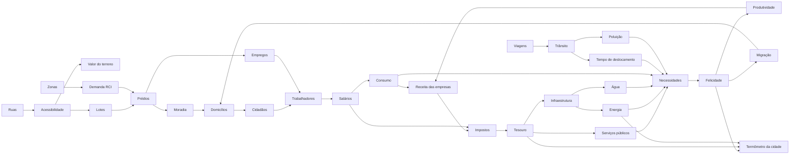

# Simulação da Cidade — Visão Sistêmica

> **Status:** v1.0 · **Data:** 2026-10-08 · **MVP:** parcial
> Este documento mostra **como os sistemas se influenciam**. Cada sistema tem seu próprio documento.

---

## 1. Grafo causal



## 2. Laços de realimentação (dinâmica de sistemas)

| Laço | Tipo | Descrição | Amortecimento |
|---|---|---|---|
| L1 Crescimento | Reforço (+) | moradia → população → consumo → comércio → empregos → atratividade → população | limitado por moradia, energia e demanda |
| L2 Impostos | Equilíbrio (−) | impostos ↑ → felicidade ↓ e lucro ↓ → emigração/falências → receita ↓ | penalidade de imposto suave até 12%, forte acima |
| L3 Trânsito | Equilíbrio (−) | população ↑ → viagens ↑ → congestionamento → tempo ↑ → felicidade ↓ → crescimento ↓ | escolha de rota e de horário |
| L4 Energia | Equilíbrio (−) | consumo > geração → cortes → infelicidade e comércio fechado → consumo ↓ | corte por prioridade, não aleatório |
| L5 Dívida | Reforço (−) perigoso | déficit → corte de serviços → infelicidade → emigração → receita ↓ → mais déficit | alertas antecipados, empréstimo (pós-MVP), termômetro |
| L6 Valor do terreno | Reforço (+) | serviços/parques → valor ↑ → impostos ↑ → mais serviços | teto por bairro |

**Regra de projeto:** todo laço de reforço precisa de pelo menos um limitador explícito, documentado e testado em teste de balanceamento.

## 3. Modelo genérico de serviço
Usado por energia, água, lixo, saúde, educação, polícia, bombeiros e transporte (cada documento especializa este modelo).

| Atributo | Definição |
|---|---|
| **Custo** | construção (único) + manutenção diária + custo por unidade atendida |
| **Capacidade** | unidades atendidas por período (kW, m³/dia, pacientes/dia, alunos) |
| **Cobertura** | conjunto de nós/lotes alcançáveis dentro de um tempo de viagem T (Dijkstra multi-fonte no grafo viário) |
| **Eficiência** | 0–100%, função de orçamento alocado (%), funcionários presentes/necessários e condição do prédio |
| **Funcionários** | vagas de emprego (cidadãos reais) |
| **Demanda** | soma das necessidades da população coberta |
| **Saturação** | demanda / (capacidade × eficiência). Acima de 100% gera fila/espera e queda de satisfação |

```
Satisfação do serviço para um lote = cobertura(lote) × min(1, oferta efetiva / demanda) × qualidade
```

## 4. Balanceamento
- **Dados, não código:** custos, capacidades, pesos e limiares ficam em `content/catalogs/*.json`, com versão.
- **Testes de balanceamento** (*headless*, CI noturno): cidades roteirizadas (ex.: "vila de 50 habitantes", "cidade de 5k com indústria") simuladas por 1–10 anos de jogo, verificando faixas (desemprego 3–12%, saldo diário, felicidade média 55–80).
- **Ferramenta de exploração:** CLI que simula N dias e exporta CSV por indicador, para gráficos e ajuste.
- **Telemetria local** (opt-in) de playtests: tempo até falência, causas de infelicidade mais comuns.

## 5. Explicabilidade transversal
Todo sistema publica **contribuições** (ver `DOMAIN_MODEL.md` §8). O Inspector e o painel "Por quê?" nunca calculam causas por conta própria: eles **leem** o que os sistemas registraram.

## 6. Escopo por fase
| Sistema | MVP | Fase |
|---|---|---|
| Ruas, lotes, prédios básicos | ✅ | 3–4 |
| Cidadãos, domicílios, agenda, caminhada | ✅ | 5 |
| Ledger, salários, impostos, orçamento | ✅ | 6 |
| Energia, necessidades, felicidade, termômetro | ✅ | 7 |
| Zoneamento, demanda RCI, valor do terreno | — | 10 |
| Trânsito e veículos | — | 11 |
| Água, esgoto, lixo, poluição | — | 12 |
| Saúde, educação, polícia, bombeiros, problemas | — (apagão v0) | 13 |
| Transporte público, clima, eventos | — | 19 |
