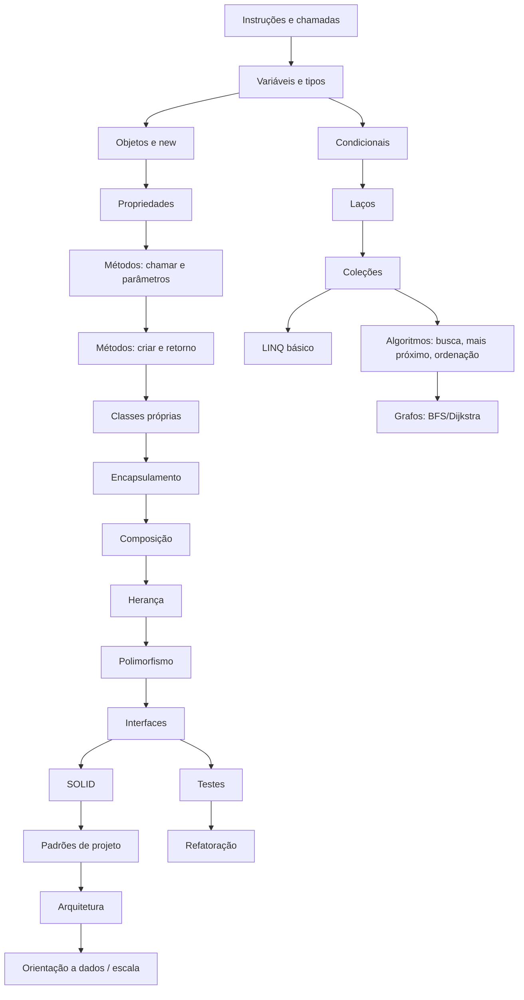

# Trilha de Aprendizagem

> **Status:** v1.0 · **Data:** 2026-10-08 · **MVP:** Módulos 0–2
> A sequência do §2/§50 do briefing é mantida como **espinha dorsal**, mas implementada como **grafo de conceitos** (DAG) com pré-requisitos.

---

## 1. Grafo de conceitos (visão)

## 2. Módulos

| Módulo | Conceitos | Problema da cidade que motiva | Fase |
|---|---|---|---|
| **M0 – Primeiros passos** | instrução, chamada de método, string, comentário | "A prefeitura precisa se comunicar" (`city.Log`) | MVP |
| **M1 – Dados** | variáveis, tipos (`int`, `decimal`, `double`, `bool`, `string`), operadores, `decimal` para dinheiro | ler o orçamento, prever saldo | MVP |
| **M2 – Objetos** | objeto, `new`, propriedades, métodos (chamar/criar), retorno, sobrecarga, classe própria | construir e projetar casas, calcular consumo | MVP |
| **M3 – Decisões e repetição** | `if/else`, `switch`, laços (`for`, `foreach`, `while`) | construir em série, reagir a déficit | 9–10 |
| **M4 – Coleções e algoritmos** | `List<T>`, `Dictionary<K,V>`, busca linear, mínimo/máximo, ordenação, LINQ básico | "encontre o centro de coleta mais próximo" (§27) | 12 |
| **M5 – Encapsulamento e composição** | modificadores de acesso, invariantes, validação, composição (`Hospital` → departamentos) | prédios com regras próprias | 14 |
| **M6 – Herança e polimorfismo** | herança, `virtual/override`, `abstract`, polimorfismo (`CalculateMaintenanceCost`) | tipos de prédios e veículos de serviço | 14 |
| **M7 – Interfaces** | interfaces, contratos, Strategy (overlays, rotas) | "cada veículo calcula a rota do seu jeito" (§74) | 14 |
| **M8 – SOLID** | SRP, OCP, LSP, ISP, DIP | código legado `CityManager` | 15 |
| **M9 – Padrões** | Factory, Strategy, Observer, Command, State, Builder, Specification, Repository, Mediator | dores reais (`DESIGN_PATTERNS.md`) | 16 |
| **M10 – Testes** | `[Test]`, AAA, fakes, teste que pega bug, TDD leve | "o cálculo da conta de luz tem um bug" | 17 |
| **M11 – Refatoração e arquitetura** | extrair método/classe/interface, camadas, dependências | a cidade cresceu, o código também | 15–18 |
| **M12 – Escala** | complexidade, lote × um a um, orientação a dados | "50 mil cidadãos e seu código ficou lento" | 18 |
| **M13 – Grafos** | BFS, Dijkstra, cobertura | serviços e rotas | 13 |

## 3. Lições do MVP (detalhe em `MVP.md` §3.5)
1. Bom dia, prefeito(a) (M0)
2. Quanto temos no cofre? (M1)
3. Sua primeira casa (M2: objeto)
4. Projetando a casa (M2: propriedade, `CS0200`)
5. Onde construir? (M2: método com parâmetros, sobrecarga; propriedade × método)
6. Calculando o consumo (M2: método com retorno, Laboratório)
7. Seu primeiro projeto (M2: classe própria `EnergyAuditor`)
8. ★ Crise de energia (integração)

## 4. Exemplo de arco completo (§74, Missão do lixo)
| Etapa | Fase | Situação | Conceito |
|---|---|---|---|
| 1 | 12 | "O bairro norte está acumulando lixo" | classe, método, parâmetros, coleções, laços (`GarbageCollector.Collect(areas)`) |
| 2 | 12 | "encontre o depósito mais próximo" | algoritmo de mínimo; depois BFS/Dijkstra (M13) |
| 3 | 14 | "existem tipos de veículos: lixo, ônibus, polícia, bombeiros" | herança (`Vehicle` → subtipos) |
| 4 | 14 | "cada um calcula rota diferente" | polimorfismo e interface (`IRouteStrategy`) |
| 5 | 15–16 | "o sistema ficou difícil de manter: 12 tipos e `if` por toda parte" | Strategy + OCP/SRP |
| 6 | 17 | "um bug manda caminhões para o depósito lotado" | teste que reproduz o bug, correção |

## 5. Critérios de domínio por conceito
Um conceito é considerado **dominado** quando o modelo do aluno (`LEARNING_ENGINE.md`) estima P(domínio) ≥ 0,85, a partir de: desafio principal resolvido com ≤ 1 dica, um exercício de variação resolvido e uma revisão espaçada correta.
