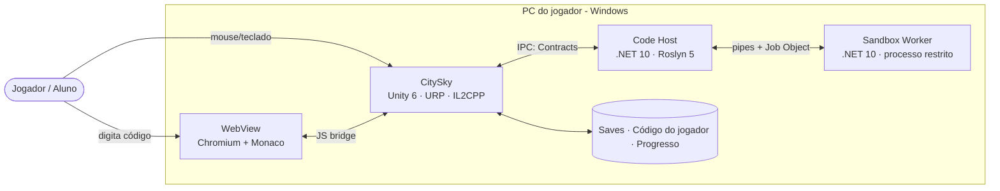
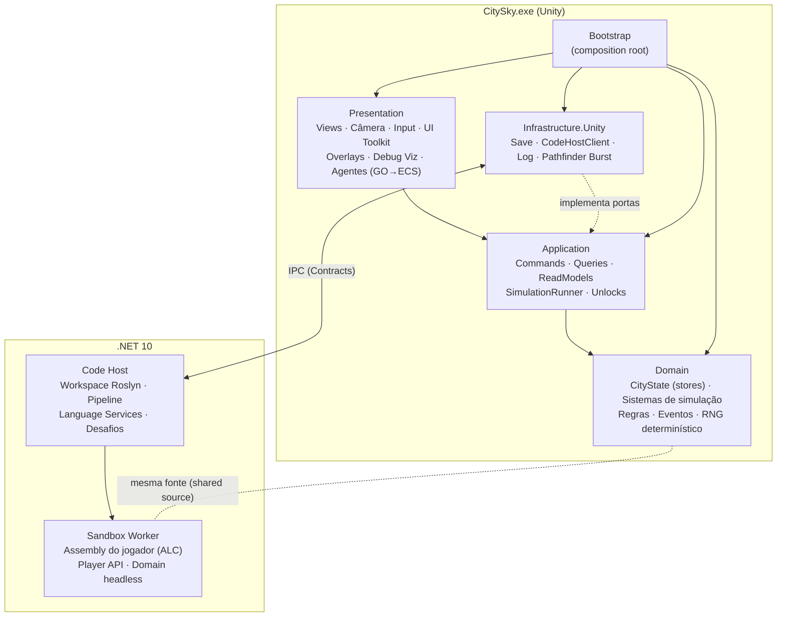
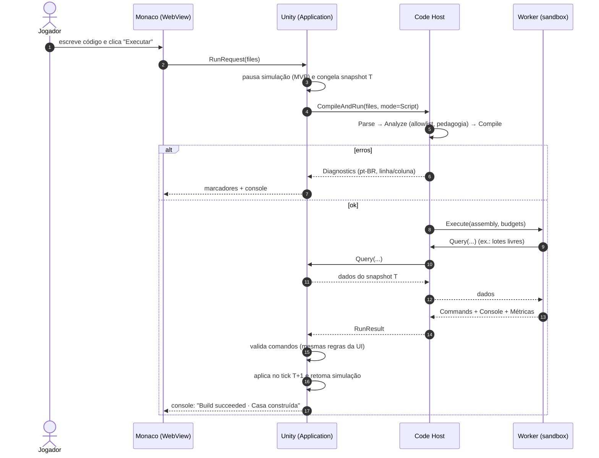
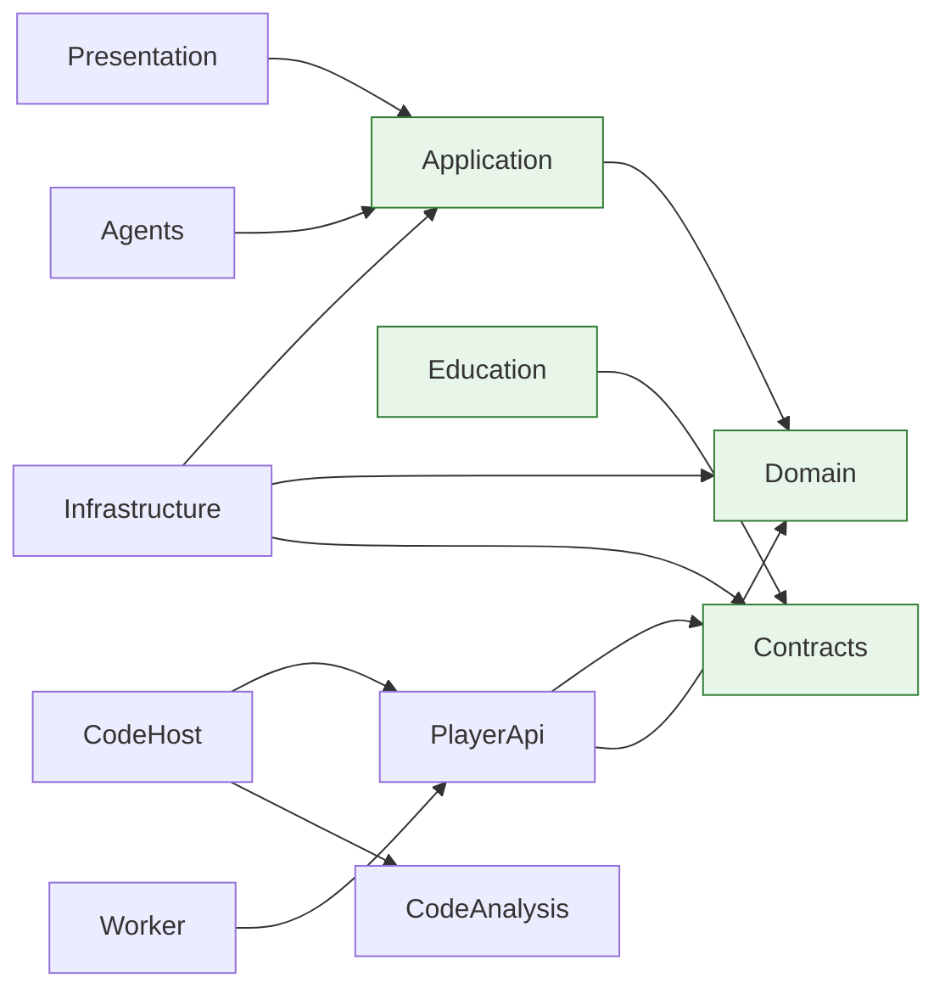

# Arquitetura do Projeto — Diagrama Geral

> **Status:** v1.0 · **Data:** 2026-10-08
> Visão consolidada em uma página. Detalhes em [`ARCHITECTURE.md`](ARCHITECTURE.md), [`SIMULATION_ARCHITECTURE.md`](SIMULATION_ARCHITECTURE.md), [`CODE_EXECUTION.md`](CODE_EXECUTION.md).

---

## 1. Visão de contexto (C4 nível 1)



## 2. Contêineres e camadas (C4 nível 2)



## 3. Simulação (pipeline de um tick)

```mermaid
flowchart LR
    T0([Tick N]) --> C[Aplicar comandos<br/>ordenados]
    C --> S1[Calendário/Clima]
    S1 --> S2[Cidadãos: agenda<br/>baldes]
    S2 --> S3[Viagens + Pathfinding<br/>com orçamento]
    S3 --> S4[Tráfego meso]
    S4 --> S5[Utilidades<br/>energia/água]
    S5 --> S6[Economia<br/>ledger]
    S6 --> S7[Necessidades e Felicidade<br/>baldes]
    S7 --> S8[Serviços/Problemas/Eventos]
    S8 --> S9[Saúde da cidade]
    S9 --> E[Publicar eventos<br/>de domínio]
    E --> R[ReadModels<br/>dirty only]
    R --> T1([Tick N+1])
    R -. leitura .-> V[[Apresentação<br/>interpola por frame]]
```



> Cada sistema roda no seu **período em ticks** (nem todo sistema roda todo tick). Ver `SIMULATION_TICK.md`.

## 4. Código do jogador → cidade



## 5. Mapa de dependências (regra)



Verde = sem engine (`noEngineReferences`), compartilhado entre Unity e .NET.

## 6. Onde cada tecnologia atua

| Camada / processo | Tecnologias |
|---|---|
| Presentation | Unity 6, URP (Forward+, GRD, GPU Occlusion), UI Toolkit, Input System, Splines (ferramentas), Terrain, Localization, (Fase 11+) Entities + Entities Graphics + Burst + Jobs |
| Application / Domain | C# 9, netstandard2.1, sem dependências externas |
| Infrastructure.Unity | Newtonsoft.Json, System.IO, IPC (named pipes/TCP), Burst (pathfinder acelerado, Fase 11+) |
| Code Host | .NET 10, Roslyn 5.x (CSharp, Features, Workspaces), Microsoft.Extensions.Hosting/Logging, Newtonsoft.Json |
| Sandbox Worker | .NET 10, AssemblyLoadContext coletável, Job Object + token restrito/AppContainer (Windows) |
| Editor | Monaco + TypeScript (Vite), host gratuito (UnityWebBrowser ou janela PhotinoX acoplada, que usa WebView2 no Windows; a decidir no spike S2; ADR-0017/0018) |
| Qualidade | NUnit (UTF + NUnit 4), BenchmarkDotNet, Unity Profiler, GitHub Actions, **dotnet-claude-kit** (skills, agentes, Roslyn MCP) |

## 7. Limites de confiança (segurança)

```
[Confiável]           Unity (jogo) ── Code Host (nosso código, roda como o usuário)
--------------------- fronteira de processo + validação de mensagens -------------
[NÃO confiável]       Sandbox Worker (código do jogador): sem rede, sem FS,
                      sem processos, memória/CPU limitadas, mata-se à vontade
--------------------- fronteira de processo + CSP + bloqueio de navegação --------
[Semiconfiável]       WebView (conteúdo local apenas)
```

Detalhes: `CODE_EXECUTION_SECURITY.md`, `SECURITY.md`.
