# Planos das Fases

> **Status:** v1.0 · **Data:** 2026-10-08 · **Fase atual:** **0** (Pesquisa, arquitetura e spikes)
> O [`DEVELOPMENT_ROADMAP.md`](../DEVELOPMENT_ROADMAP.md) diz **o quê e em que ordem**. Estes documentos dizem **como cada fase é executada**: entrada, escopo, backlog com IDs, gate de saída verificável, riscos e documentos a atualizar.

---

## 1. Como usar
- **Antes de começar qualquer tarefa**, abra o plano da fase atual e localize a tarefa pelo ID (`F3-07`). Se a tarefa não está no plano, a pergunta "pertence à fase atual?" (§75 do briefing) vem primeiro: se não pertence, ela vai para o plano da fase certa ou para o `FUTURE_FEATURES.md`.
- Commits e PRs citam o ID: `feat(roads): split segment on crossing (F3-04)`.
- **Fases do MVP (0–8)** têm backlog detalhado. **Fases pós-MVP (9–21)** são **intenções de design**: escopo, entregáveis e gate. O backlog delas é detalhado no encerramento da fase anterior, para evitar *doc rot* (`CRITICAL_ANALYSIS.md` D18).
- Ao encerrar uma fase: rodar o checklist de encerramento do plano, mudar o **Status** para "Concluída", registrar a velocidade real e reestimar as fases seguintes.

## 2. Visão geral

| Fase | Bloco | Título | Plano | Gate de saída (resumo) | Estimativa* | Status |
|---|---|---|---|---|---|---|
| 0 | A | Pesquisa, arquitetura e spikes | [F00](F00-research-and-spikes.md) | S1, S2, S6, S7 resolvidos | 5 sem | **Em andamento** |
| 1 | A | Fundação (walking skeleton) | [F01](F01-foundation.md) | `city.Log("Olá")` no jogo + hash determinístico Mono = .NET 10 | 6 sem | Planejada |
| 2 | B | Mundo: terreno, câmera, luz, seleção | [F02](F02-world.md) | orçamento do S3 mantido na cena real | 4 sem | Planejada |
| 3 | B | Estradas | [F03](F03-roads.md) | AC-02; 100 interseções ≤ 50 ms | 4 sem | Planejada |
| 4 | B | Construções | [F04](F04-buildings.md) | AC-01, AC-03, AC-05: "a casa aparece" pelo código | 3 sem | Planejada |
| 5 | B | Primeiros cidadãos | [F05](F05-citizens.md) | 50 cidadãos, 3 dias determinísticos, 0 GC/frame | 4 sem | Planejada |
| 6 | B | Economia mínima | [F06](F06-economy.md) | conservação do dinheiro + testes de balanceamento | 3 sem | Planejada |
| 7 | B | Energia, felicidade e termômetro | [F07](F07-energy-happiness.md) | AC-04, AC-06, AC-07 | 4 sem | Planejada |
| 8 | B | Aprendizado do MVP | [F08](F08-mvp-learning.md) | **🚩 GATE DO MVP**: AC-01..18 + playtest em sala | 6 sem | Planejada |
| 9 | C | Sandbox endurecido, replay, compartilhamento | [F09](F09-hardened-sandbox-replay-sharing.md) | L5 completo + corpus + fuzzing | — | Intenção |
| 10 | C | Zoneamento e crescimento | [F10](F10-zoning-growth.md) | 1.000 cidadãos; demanda RCI explicável | — | Intenção |
| 11 | C | Trânsito v1 + ECS | [F11](F11-traffic-ecs.md) | 10.000 cidadãos; ADR-0010 revisado | — | Intenção |
| 12 | C | Água, esgoto, lixo e poluição | [F12](F12-utilities.md) | redes + missão do lixo etapas 1–2 | — | Intenção |
| 13 | C | Serviços, problemas e painel do professor | [F13](F13-services-problems-teacher.md) | problemas → missões; painel com 40 alunos | — | Intenção |
| 14 | D | Currículo POO | [F14](F14-oop-curriculum.md) | módulos M5–M7 + pré/pós-teste | — | Intenção |
| 15 | D | SOLID | [F15](F15-solid.md) | `CityManager` refatorável e validada | — | Intenção |
| 16 | D | Padrões de projeto | [F16](F16-design-patterns.md) | 9 padrões com dor real | — | Intenção |
| 17 | D | Testes do jogador | [F17](F17-player-testing.md) | `[Test]` do aluno + mutantes | — | Intenção |
| 18 | E | Escala | [F18](F18-scale.md) | 50k → 100k+ cidadãos | — | Intenção |
| 19 | E | Conteúdo | [F19](F19-content.md) | transporte público, clima, eventos | — | Intenção |
| 20 | E | Polimento, piloto e lançamento | [F20](F20-polish-launch.md) | lançamento Windows (Store, itch.io, Steam) | — | Intenção |
| 21+ | — | Outras plataformas | [F21](F21-other-platforms.md) | reavaliar após o lançamento | — | Intenção |

\* **Ordem de grandeza** para 1 pessoa + agentes de IA, em semanas de trabalho. MVP ≈ **39 semanas** (~9 meses). É um chute informado, não um compromisso: recalibrar ao fim da Fase 1 com a velocidade medida. Fases pós-MVP só recebem estimativa no gate do MVP.

## 3. Dependências entre fases

```mermaid
flowchart LR
    F0[F0 Spikes] --> F1[F1 Fundação]
    F1 --> F2[F2 Mundo]
    F2 --> F3[F3 Estradas]
    F3 --> F4[F4 Construções]
    F4 --> F5[F5 Cidadãos]
    F5 --> F6[F6 Economia]
    F6 --> F7[F7 Energia e felicidade]
    F7 --> F8{{F8 Aprendizado<br/>GATE DO MVP}}
    F8 --> F9[F9 Sandbox L5,<br/>replay, compartilhamento]
    F8 --> F10[F10 Zoneamento]
    F10 --> F11[F11 Trânsito + ECS]
    F11 --> F12[F12 Utilidades]
    F12 --> F13[F13 Serviços e professor]
    F9 --> F13
    F10 --> F14[F14 POO]
    F13 --> F15[F15 SOLID]
    F14 --> F15
    F15 --> F16[F16 Padrões]
    F16 --> F17[F17 Testes do jogador]
    F13 --> F18[F18 Escala]
    F17 --> F19[F19 Conteúdo]
    F18 --> F19
    F19 --> F20[F20 Lançamento]
    F20 --> F21[F21+ Plataformas]
```

### Quando cada spike precisa estar respondido
Nem todo spike bloqueia a Fase 1. Cada um tem uma fase que **depende** da resposta:

| Spike | Bloqueia | Motivo |
|---|---|---|
| S6, S1a, S1b | **F1** | o walking skeleton usa Code Host, Worker e IPC |
| S2a, S2b | **F1** | o walking skeleton tem o editor |
| S7 | **F1** (formato de distribuição) | `IFileLocations` e o layout de pastas mudam se o app for empacotado |
| S5 | F3 | malha de ruas |
| S3 | gate da F2 | orçamento de renderização da cena real |
| S4a, S4b | F5 | orçamento de CPU por cidadão |

## 4. Trilhas contínuas (valem para toda fase)
Repetidas do roadmap para ficarem à mão: documentação no mesmo PR; benchmarks com limiar no CI; corpus de segurança cresce com a Player API; cada sistema novo traz pelo menos 1 problema → conceito; sala de aula (≤ 20 min, preset Baixo, offline, sem admin); custo zero; portabilidade (CA1416, interfaces de plataforma); fluxo dotnet-claude-kit (`/spec → /plan → /tdd → /verify → /code-review`).

## 5. Modelo
Novos planos usam [`TEMPLATE.md`](TEMPLATE.md).
